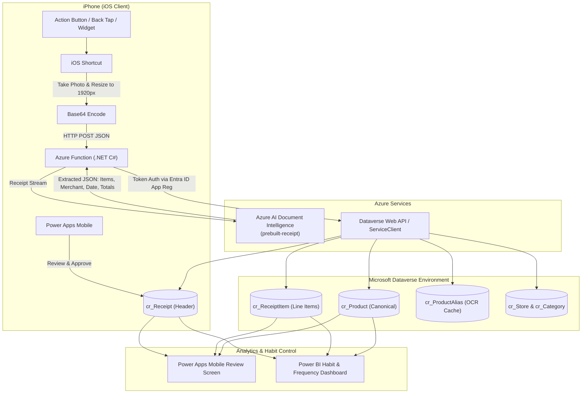

# Receipt Tracker: Power Apps + Azure Functions (.NET C#) + Dataverse + iOS Shortcuts

## 1. System Architecture Overview



---

## 2. Technical Component Specifications

### 2.1 Azure Function (.NET 7/8 Isolated Worker)
- **Project Structure**:
  - `ReceiptTracker.Functions`
    - `Functions/UploadReceiptFunction.cs`: HTTP Trigger endpoint (`POST /api/receipts/upload`).
    - `Services/DocumentIntelligenceService.cs`: Wraps `Azure.AI.DocumentIntelligence` SDK with `prebuilt-receipt`.
    - `Services/DataverseService.cs`: Uses `ServiceClient` (`Microsoft.PowerPlatform.Dataverse.Client`) or HttpClient against Dataverse Web API.
    - `Models/ReceiptUploadRequest.cs`: DTO for incoming base64 image and metadata.
    - `Models/ParsedReceiptResult.cs`: Strongly typed extraction result.
- **Key NuGet Packages**:
  - `Azure.AI.DocumentIntelligence` (or `Azure.AI.FormRecognizer`)
  - `Microsoft.PowerPlatform.Dataverse.Client`
  - `Microsoft.Azure.Functions.Worker`
  - `Microsoft.Azure.Functions.Worker.Extensions.Http`

### 2.2 Dataverse Relational Schema (`cr_` Prefix)

#### 1. `cr_Store` (Merchant)
- `cr_storeid` (GUID, Primary Key)
- `cr_name` (Text, Primary Name - e.g., "Trader Joe's", "Costco")
- `cr_defaultcategory` (Text)

#### 2. `cr_Category`
- `cr_categoryid` (GUID, Primary Key)
- `cr_name` (Text, Primary Name - e.g., "Dairy", "Coffee", "Snacks")
- `cr_isessential` (Boolean - True for essentials, False for impulse/discretionary)
- `cr_targetfrequencydays` (Integer - e.g. 14 days for coffee beans, 21 for snacks)

#### 3. `cr_Product` (Canonical Master Item)
- `cr_productid` (GUID, Primary Key)
- `cr_canonicalname` (Text, Primary Name - e.g., "Organic Whole Milk 1 Gal")
- `cr_categoryid` (Lookup to `cr_Category`)
- `cr_unitofmeasure` (Choice: Pack, Gallon, lb, Each, oz)
- `cr_isrecurring` (Boolean)

#### 4. `cr_ProductAlias` (OCR Normalization Cache)
- `cr_productaliasid` (GUID, Primary Key)
- `cr_rawocrname` (Text, Primary Name - exact OCR text, e.g., `"ORG WHL MILK 1G"`)
- `cr_productid` (Lookup to `cr_Product`)
- `cr_storeid` (Lookup to `cr_Store`)

#### 5. `cr_Receipt` (Header)
- `cr_receiptid` (GUID, Primary Key)
- `cr_storeid` (Lookup to `cr_Store`)
- `cr_purchasedate` (Date Only)
- `cr_subtotal` (Currency)
- `cr_tax` (Currency)
- `cr_totalamount` (Currency)
- `cr_status` (Choice: `Pending Review` [default], `Confirmed`, `Archived`)
- `cr_receiptimage` (File / Image column)

#### 6. `cr_ReceiptItem` (Line Item)
- `cr_receiptitemid` (GUID, Primary Key)
- `cr_receiptid` (Lookup to `cr_Receipt`, Cascade Delete)
- `cr_productid` (Lookup to `cr_Product`)
- `cr_rawitemname` (Text)
- `cr_quantity` (Decimal, 3 decimals)
- `cr_unitprice` (Currency)
- `cr_totalprice` (Currency)
- `cr_discount` (Currency)
- `cr_confidencescore` (Decimal)

---

## 3. Data Flow & Logic in the .NET Azure Function

1. **HTTP Ingestion**:
   - Receives JSON payload: `{ "imageBase64": "...", "fileName": "receipt.jpg" }`.
   - Converts base64 to binary stream.
2. **Azure AI Document Intelligence Call**:
   - Calls `AnalyzeDocumentAsync("prebuilt-receipt", stream)`.
   - Extracts:
     - Merchant Name (`receipt.Fields["MerchantName"]`)
     - Transaction Date (`receipt.Fields["TransactionDate"]`)
     - Subtotal, Tax, and Total Amount
     - Line Items (`receipt.Fields["Items"]`) $\rightarrow$ description, quantity, price, unit price.
3. **Dataverse Persistence & Alias Resolution**:
   - Query `cr_Store` where `cr_name == extractedMerchantName`. If not found, create new `cr_Store`.
   - Create `cr_Receipt` with status `Pending Review`.
   - For each extracted line item:
     - Query `cr_ProductAlias` where `cr_rawocrname == item.Description`.
     - If alias found: set `cr_productid = alias.cr_productid`.
     - If not found: leave `cr_productid` null (or create provisional product).
     - Insert `cr_ReceiptItem` record.
4. **Response back to iOS Shortcut**:
   - Returns HTTP 200 with JSON summary:
     ```json
     {
       "success": true,
       "receiptId": "c5f1a238-...",
       "storeName": "Trader Joe's",
       "date": "2026-11-01",
       "itemCount": 6,
       "totalAmount": 34.82,
       "message": "Receipt parsed successfully. 6 items added for review."
     }
     ```

---

## 4. iOS Shortcut Configuration

Create a shortcut named **"Scan Receipt"**:
1. **Take Photo**: Camera: Back, Quality: High.
2. **Resize Image**: Width: `1920`, Height: Auto.
3. **Base64 Encode**: Line Breaks: None.
4. **Dictionary**:
   - `imageBase64`: Output of Base64 Encode
   - `fileName`: `receipt.jpg`
5. **Get Contents of URL**:
   - URL: `https://<your-func>.azurewebsites.net/api/receipts/upload?code=<function-key>`
   - Method: `POST`
   - Headers: `Content-Type: application/json`
   - Request Body: JSON with the dictionary.
6. **Get Value for `message` in Dictionary from URL Contents**:
7. **Show Notification**:
   - Title: `Receipt Tracker`
   - Message: `[message]` (e.g., "Trader Joe's - $34.82 (6 items)")
8. **Optional**: Deep link `ms-apps://...` to open the Power Apps canvas app directly on the review screen.

---

## 5. Power Apps Canvas App (Mobile Phone Layout)

### Screen 1: Pending Receipts Inbox
- Gallery displaying all receipts where `cr_status = 'Pending Review'`.
- Displays Store Name, Date, Item Count, and Total Amount.
- Tap a card to navigate to the **Review Screen**.

### Screen 2: Line-Item Review & Verification
- Header with Store Name, Date, and Total.
- Thumbnail of receipt image (expandable to full screen).
- Gallery of `cr_ReceiptItem` records:
  - Text input for raw item name.
  - Dropdown/Combobox to pick or search canonical `cr_Product`.
  - Numeric inputs for Quantity, Unit Price, Total Price.
- **"Confirm & Approve" Button**:
  - Updates `cr_Receipt` status to `Confirmed`.
  - For each item where `cr_product` is populated, automatically upserts a record in `cr_ProductAlias` (`cr_rawocrname` $\rightarrow$ `cr_productid`), ensuring future scans of this item require zero manual touches.

### Screen 3: Frequency & Habit Dashboard
- Gallery of recurring products showing:
  - Product Name & Category
  - Last Purchased Date
  - Calculated Days Elapsed ($\text{Today} - \text{LastPurchaseDate}$)
  - Average Interval (Days)
  - Status Pill:
    - 🟢 "On Track"
    - 🔴 "Impulse / Ahead of Schedule" (if non-essential item bought < 60% of average cycle)

---

## 6. Power BI Analytics Dashboard

Connect Power BI to Dataverse using the native **Dataverse (TDS Endpoint)** connector:
- **Replenishment Velocity**: Average interval between purchases per product over 30/60/90 days.
- **Price Creep / Inflation**: Line chart of unit prices per product across different stores.
- **Discretionary vs Essential Breakdown**: Total spend and frequency ratio between essential groceries vs impulse snacks/takeout.

---

## 7. Step-by-Step Implementation Roadmap

### Step 1: Dataverse Foundation [VERIFIED & CONNECTED]
- Solution `ReceiptTracker` created with 6 custom tables.
- Entra ID App Registration (`ReceiptTracker`) authenticated and validated.
- Dataverse Application User verified with active `WhoAmI` response.
- End-to-end record insertion verified (`cr_store1s`, `cr_receipts`, `cr_receiptitems`).

### Step 2: .NET C# Azure Function [VERIFIED & FULLY CONFIGURED]
- Scaffolded .NET Isolated Worker project `ReceiptTracker.Functions` targeting .NET 7.
- Integrated `Azure.AI.DocumentIntelligence` SDK with `prebuilt-receipt` model in `DocumentIntelligenceService.cs`.
- Azure Document Intelligence live resource (`receipttrackinginstance`) verified and tested with sample receipts.
- Implemented `DataverseService.cs` using OData v9.2 Web API and `ClientSecretCredential` token authentication.
- Live credentials stored in `local.settings.json`.
- Compiled and verified with 0 errors and 0 warnings.

### Step 3: iOS Shortcut Setup
- Configure Shortcut on iPhone with camera capture, base64 encoding, and POST request.
- Test end-to-end receipt scan from iPhone to Dataverse.

### Step 4: Power Apps Canvas App Development
- Create Phone Canvas app in Power Apps Studio.
- Build Review screen with inline item editing and auto-alias learning on approval.
- Build frequency watchlist.

### Step 5: Power BI Analytics
- Build habit & frequency dashboard and publish to Power BI workspace.
